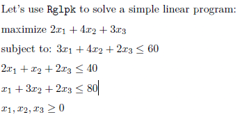
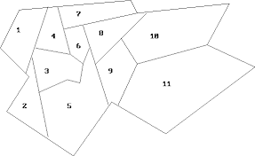
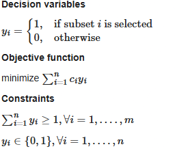
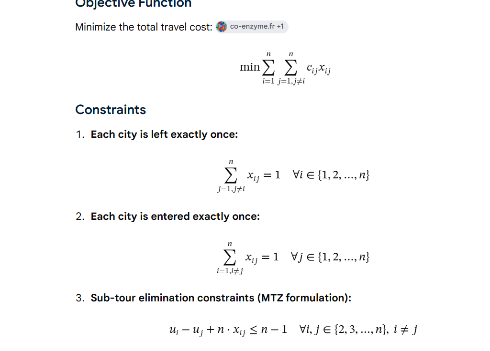

```{r}
library(Rglpk)
```

a\) Matrix- Vector Formulation for



```{r}
obj_vector=c(2,4,3);obj_vector
constraint_mat=rbind(c(3,4,2),c(2,1,2),c(1,3,2),c(1,1,1));constraint_mat
cons_sign=c('<=','<=','<=','>=');cons_sign
rhs_con=c(60,40,80,0);rhs_con


Rglpk_solve_LP(obj = obj_vector, mat = constraint_mat, dir = cons_sign, rhs = rhs_con, max = TRUE) # use Max since this is a maximization problem, min if it was minimization


```

```{r}
# Maximise the total skill ST cost contraint

name <- c("Aaron", "Vongani", "Njabulo", "Ray", "Ace", "Alyssa", "Larry", "Wes", "Mpho", "Jimmy")
pos <- c("STR", "STR", "DEF", "DEF", "DEF", "MID", "MID", "MID", "GK", "GK")
skill <- c(167, 136, 195, 174, 144, 135, 89, 81, 114, 111)
cost <- c(60, 47, 63, 62, 40, 60, 50, 35, 40, 40)

#Decision var xi equal eithet 0 (exclusion) or 1(inclusion)

obj_vector=skill


# Contrainsts
cons_str=c(1,1,rep(0,length(name)-2)) # striker constriant
cons_def=c(rep(0,2),1,1,1,rep(0,length(name)-5)) # defender constraint
cons_mid=c(rep(0,5),1,1,1,rep(0,length(name)-8)) #midfielder constraint
cons_gk=c(rep(0,8),1,1) #GK constraint

length(cost);length(cons_str);length(cons_def);length(cons_mid);cons_gk


cons_mat=rbind(cost,cons_str,cons_def,cons_mid,cons_gk)
cons_mat

rhs_=c(300,1,2,2,1)
signs=c('<','==','==','==','==')

my_types <- rep("B", length(name)) # enforces boolean output!

lp_sol=Rglpk_solve_LP(obj = obj_vector, mat = cons_mat, types = my_types,,dir = signs, rhs = rhs_, max = TRUE) 


# Get chosen 
chosen_players=name[which(lp_sol$solution==1)];chosen_players
lp_sol


```

### Using Sparse Matrices Instead

```{r}

example_mat=matrix(c(0, 1, 0, 0, 0, 0, 0, 0, 0, 0, 3, 0), nrow = 4, ncol = 3)

# get indicies of values that are non-zero
non_zero_positions=which(example_mat!=0,arr.ind = T)


#extract these values
for(i in 1:dim(non_zero_positions)[1]){
  non_zero_val=example_mat[unname(non_zero_positions[i,])[1],unname(non_zero_positions[i,])[2]]
  print(non_zero_val)

}

# Use sparse mat
# notation i=c() col indicies, j=row indicies

data.frame(i=c( unname(non_zero_positions[,'row'])   ), j=c( unname(non_zero_positions[,'col'])   ) ,value=c(1,3) )


# Sparse Matrix for the football problem


# i= row indicies of non zero values, repeated for n nonzero values in THAT row
# j= col indicies of non zero values, repeated for n nonzero values in THAT col
my_i <- c(1, 1, 2, 2, 2, 3, 3, 3, 4, 4) # row indices, e.g there are 2 non zero vals in the first row hence 1,1

my_j <- c(1, 2, 3, 4, 5, 6, 7, 8, 9, 10) # col indicies, same logic

my_v <- rep(1, 10) # coefficients, in this case all non_zero vals=1

# Store in sparse

sparse_mat_positions <- simple_triplet_matrix(i = my_i, j = my_j, v = my_v)

# Apply the same format for the cost constraint 

sparse_mat_costs <- simple_triplet_matrix(i = rep(1, 10), j = 1:10, v = cost)


# Now rbind the two to get the complete constraint matrix

sparse_mat <- rbind(sparse_mat_positions,sparse_mat_costs)
table(sparse_mat$i) # How many values in row i are non zero


# Alternatively without using Rbind
alt_sparse_mat <- simple_triplet_matrix(i = c(my_i, rep(5, 10)), j = c(my_j, 1:10), v = c(my_v, cost))


# Now solve as before
Rglpk_solve_LP(obj = skill, mat = alt_sparse_mat , types = my_types,dir = signs, rhs = rhs_, max = TRUE) 
```

### More Examples

**Project Choice Example\
**Suppose we have identied four investment opportunities and we have R14000 to invest. Project 1 requires an investment of R5,000 and has a present value (a time-discounted value) of R8,000; Project 2 requires R7,000 and has a value of R11,000; Project 3 requires R4,000 and has a value of R6,000; and Project 4 requires R3,000 and has a value of R4,000. **The question is: into which projects should we place our money in order to maximize our total present value?**

-   Only two projects can be selected

-   If project 1 is selected, project 3 must also be selected

-   If project 2 is selected, project 4 cannot be selected

```{r}

obj_vals=c(8,11,6,4) # cost coeff in obj
cost_cont=c(5,7,4,3) #cost constrint
num_cont=c(1,1,1,1)# nr of investments contsr
choice_cont1=c(1,0,1,0) # proj choice 1
choice_cont2=c(1,1,1,0) #proj choice 2

const_matrix=rbind(cost_cont,num_cont,choice_cont1,choice_cont2);const_matrix

rhs_=c(14,2,2,2) # constrain vals cost, nr of invs
signs=c('<=','==','==','==')

my_types <- rep("B", length(name)) # enforces boolean output!
Rglpk_solve_LP(obj = obj_vals, mat = const_matrix, types = my_types,dir = signs, rhs = rhs_, max = TRUE) 

# We choose investment 1 and 3


```

**Set covering problem\
**The City of Cape Town's Health Department is planning to improve access to healthcare services across the city. The city is divided into 11 districts, as shown in the map below.\
\


Due to budget constraints, it is not possible to build a hospital in every district. Instead, the Health Department wants to determine the minimum number of hospitals that need to be built while ensuring that residents in every district have access to a hospital. A district is considered covered if

-   a hospital is built within the district itself, or

    -   a hospital is built in a neighbouring district. Here, two districts are considered neighbours if they share a common border.

```{r}
For example, District 1 has Districts 2, 3, and 4 as its neighbouring districts. Formulate an IP model that determines which districts should have hospitals built in them, and the minimum number of hospitals required to ensure that every district has access to at least one hospital in either its own district or a neighbouring district.

{width="336"}\


#1 if district are neighbours, 0 otherwise

neighbour_matrix=matrix(0,nrow=11,ncol=11)
diag(neighbour_matrix)=rep(1,length(diag(neighbour_matrix)))
neighbour_matrix[1,2:4]=c(1,1,1)
neighbour_matrix[2,1:3]=1
neighbour_matrix[2,5]=1
neighbour_matrix[3,1:6]=1
neighbour_matrix[4,1]=1
neighbour_matrix[4,3]=1
neighbour_matrix[4,6:7]=1

neighbour_matrix[5,2:3]=1
neighbour_matrix[5,6]=1
neighbour_matrix[5,9]=1
neighbour_matrix[6,3:5]=1
neighbour_matrix[6,7:8]=1

neighbour_matrix[7,4]=1
neighbour_matrix[7,6]=1
neighbour_matrix[7,8]=1

neighbour_matrix[8,6:10]=1
neighbour_matrix[9,5]=1
neighbour_matrix[9,8]=1
neighbour_matrix[9,10:11]=1

neighbour_matrix[10,8:11]=1

neighbour_matrix[11,9:11]=1


#isSymmetric(neighbour_matrix) # Symmetric matrix!

# Get the nr of bordering districts per district- these will be used as the weights in the Obj Function
district_weights=apply(neighbour_matrix,1,sum)-1 # remove the district itself


my_types <- rep("B", length(district_weights)) # enforces boolean output!
obj_vect=rep(1,11)
const= neighbour_matrix 
rhs_=rep(1,11)
dir_vec=rep('>=',11)


Rglpk_solve_LP(obj = obj_vect, mat = const , types = my_types,dir = dir_vec, rhs = rhs_, max = FALSE) # minimization prolem


```

**Knapsack Problem**

A traveller is preparing for a trip and has a knapsack (bag) with a limited carrying capacity. There are n dierent items available, and each item has a certain weight and value. The traveller would like to select items to take with them so that the total value is maximised, while ensuring that the total weight does not exceed the capacity of the knapsack.

```{r}

obj_coeff=c(4,2,1,10,2)

const=matrix(c(12,2,1,4,1),nrow=1,ncol=length(obj_coeff))

rhs_=c(15)

sign=c('<=')


my_types <- rep("B", length(obj_coeff))

Rglpk_solve_LP(obj = obj_coeff, mat = const , types = my_types,dir = sign, rhs = rhs_, max = T)


```

**Travelling salesman problem**

A Cape Town manufacturing company owns and operates several computer controlled machines that can be programmed to perform precise drilling and machining operations. The company is currently programming its drilling machine for a job that requires nine holes to be drilled in precise locations on a at breglass panel that is used in the production of a popular sports car. After each hole is drilled the machine will retract the drill bit automatically, and move it to the next location until all the holes have been drilled. Due to the fact that the machine will be required to repeat this process for several hundred thousand panels the company is interested in making sure that it programs the machine to drill the series of holes in the most efficient manner. In particular the company wants to minimise the total distance the drill bit must be moved to complete the nine drilling operations. How can you help the company achieve its objective?

TSP Obj Formulation : see here:<https://co-enzyme.fr/blog/traveling-salesman-problem-tsp-in-cplex-opl-with-miller-tucker-zemlin-mtz-formulation/>

In the formulation above, notice that

(1) Go-to constraints: the first set of equalities requires that each stop is arrived at from exactly one other stop.

(2) Come-from constraints: the second set of equalities requires that from each stop there is a departure to exactly one next stop.

Notice that these constraints do not guarantee the formation of a single tour encompassing all stops, allowing the formation of subtours.

(3) Subtour elimination: The subtour elimination constraints work by labeling the order in which the nodes are visited. Let’s call u the rank of each node in order of visits. Then ( x i j = 1 ) ⇒ ( u iu j ) (x ij ​ =1)⇒(u i ​ +1=u j ​ ). This constraint is not linear, therefore it is replaced by its big-M equivalent (3)

Besides MTZ constraints, there are several other formulations for the subtour elimnation contraint, including circuit packing contraints and network flow constraints.

```{r}

# objective is given by:
#min sum(from 1 to 9 rows)sum(from 1 to 9 columns) dij xij where xij is binary

#dij is distance matrix value

N=8
points=1:N
point_cords=c(1,1)
for(i in points) {
 point_cords= rbind(point_cords,c(1,i))
  
}
distance_mat=as.matrix(dist(point_cords, diag = T, upper = T))


obj_coeff=rbind(distance_mat,rep(0,N+1)) #dij +uij( i think)
obj_coeff_flat=as.vector(obj_coeff)
obj_coeff_flat

cons1=matrix(0,ncol=9,nrow=9) # each row should contain at leasrt 1/ incoming node
diag(cons1)=1

cons1

cons2=matrix(0,ncol=9,nrow=9)
diag(cons1)=1

cons1


```
