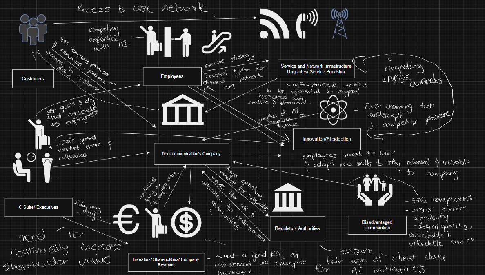
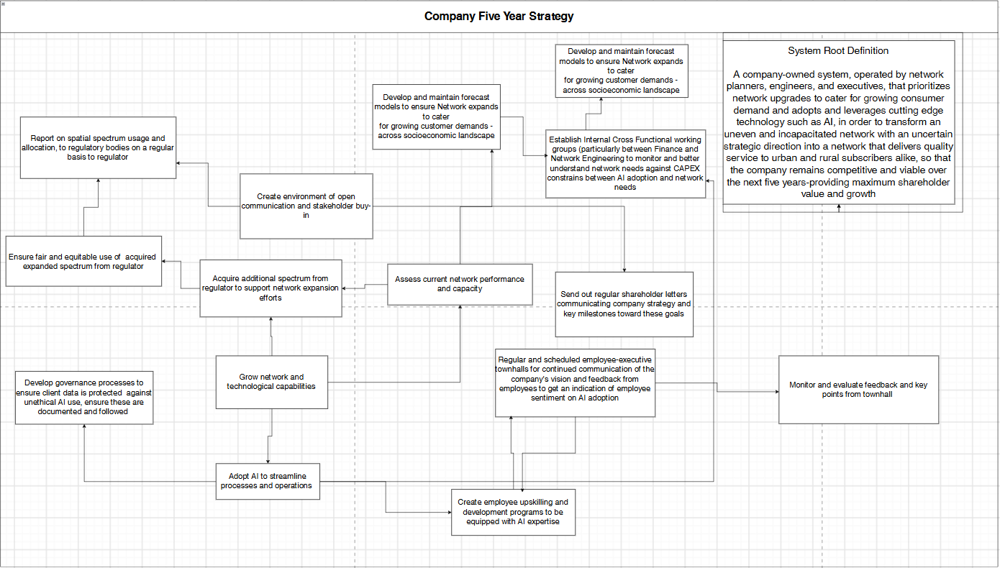

# The Messy Problem

**Competing Interests**

A telecommunications company must decide which network sites to upgrade over the next five years in order to remain competitive in a fast-changing and highly contested market. These decisions must balance the coverage needs of customers across different socio-economic strata, including a commitment to maintaining quality coverage in rural and remote communities, even where these are not the most revenue-generating. They are further constrained by legal and regulatory conditions governing the spectrum available to the company, intended to ensure fair competition, and by how that spectrum is distributed across sites already in the network.

At the same time, the company has set a strategic ambition to transform from a traditional telecoms operator into a leader at the forefront of industry innovation, in line with increasing shareholder value. This has driven a growing push to adopt AI across its operations and business strategy, requiring significant capital expenditure that competes with network investment. The push has also generated unease within the workforce, where many employees fear that AI will make their roles redundant and feel they have not been brought along or shown a place in the company’s next strategic direction. Additionally, the company’s leadership culture relies heavily on positional power and top-down decision-making, which slows feedback loops and limits the extent to which employee concerns and frontline knowledge can inform strategic choices.

#### Key Conflicts:

-   Competitive Edge vs Social Responsibility

-   Technology Adoption vs Employee buy-in

-   Regulatory requirements vs Shareholder Value (Continued Revenue Growth)

# Problem Expression

#### System Root Definition

A company-owned system, envisioned executives, that prioritizes technology expansion and AI adoption to grow company value, ensure that the company remains competitive and viable over the next five years inline with fiduciary obligations to shareholders.\*comeback

Customers: Subscribers, Shareholders

Actors: Network Planners, Engineers, and C-Suite Executives

Transformation: Improved network service through the upgrade of existing sites and expanded coverage for remote areas

Worldview (from executives' perspectives): quality coverage and innovation are both necessary to remain viable

Owners: Company C Suite, set the business strategy and cascade goals to different parts of the company. Decide on the allocation of strategic investments and expenditure that the company adopts. Have a fiduciary obligation to shareholders.

Environmental constraints: spectrum regulation, capital limits, competitors, technology change

#### Subsystem Root Definition (Network Engineers and Planners) \* comeback

A technical system owned by by network planners, engineers that priorities and upgrades network sites to ensure growing demand is met and deliver excellent service to network customers. within regulatory spectrum limits, in order to transform an uneven network and an uncertain strategic direction into a network that delivers quality service to urban and rural subscribers alike,

**Rich Picture** **the problem**

{width="552"}

Activities Required to make the Root Definition True

-   Company initiatives and employee development program to use and leverage AI in daily working processes and operations. Posit the use of AI and an enhancer of the work process for employees, and not a replacement.

-   Regulatory consultations and reporting to ensure network technology expansion is in line with legal requirements as well as ESG obligations w.r.t rural network accessibility.

-   Use cross-functional working- specifically groups to equip and educate network planners and engineers to understand and optimize for financial constraints that required network upgrades are under and educate the finance department of the needs to ensure that the network can support increasing customer demand

-   Continuous engagement between employees and executives via town halls and workshops to secure employee buy-in in the broader vision and goals of the company and to ensure that executives are in the loop w.r.t employee sentiment (creates environment of open communication and feedback).

Combined Root Definition:\
\
System Root Definition\
\
A company-owned system, operated by network planners, engineers, and executives, that prioritizes network upgrades to cater for growing consumer demand and adopts and leverages cutting edge technology such as AI, in order to transform an uneven and incapacited network with an uncertain strategic direction into a network that delivers quality service to urban and rural subscribers alike, so that the company remains competitive and viable over the next five years-providing maximum shareholder value and growth.\



\
**SSM Model**\
\
{width="549"}
