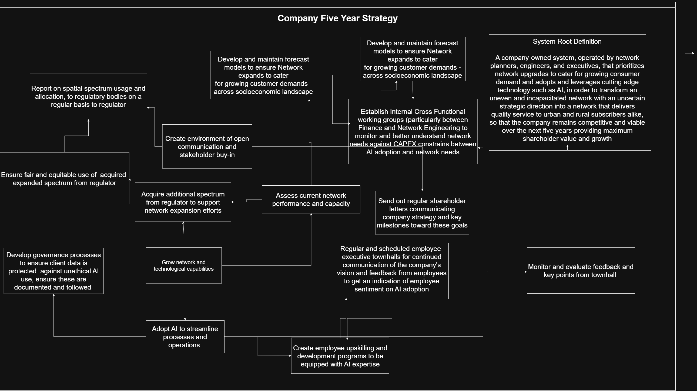
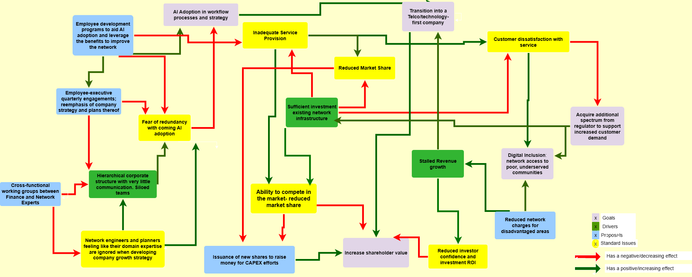

\newpage
\includepdf[pages=1]{STA PLAGIARISM DECLARATION_PA_filled.pdf}

# The Messy Problem

**Competing Needs**

A telecommunications company has been in a period of stalled growth, accompanied by a constrained network. The company must decide which network sites to upgrade over the next five years to remain competitive in a fast-changing and highly contested market. These decisions must balance the coverage needs of customers across different socio-economic strata, including a commitment to maintaining quality coverage in rural and remote communities, even where these are not the most revenue-generating. They are further constrained by legal and regulatory conditions governing the spectrum the company can purchase to grow its network capability, intended to ensure fair competition.\
Additionally, the company has set a strategic ambition to transform from a traditional telecoms operator into a leader at the forefront of industry innovation, in an effort to increase shareholder value and raise the necessary capital to aid its expansion efforts. This has driven a growing push to adopt AI across its operations and business strategy, requiring significant capital expenditure that competes with network investment. The push has also generated unease within the workforce, where many employees fear that AI will make their roles redundant and feel they have not been brought along or shown a place in the company’s next strategic direction. The company’s leadership culture relies heavily on positional power and top-down decision-making, which slows feedback loops and limits the extent to which employee concerns and front-line knowledge can inform strategic choices.

#### Key Conflicts:

-   Revenue Growth vs Social Responsibility/Regulatory Requirements

-   Technology Adoption vs Employee buy-in

-   Technology Investment vs Operational Capacity

# Problem Expression

**System Root Definition (Executive worldview)**

A **company-owned** system, **directed by the C-suite executives and operated by network planners, engineers and executives**, that prioritizes **and upgrades network sites and adopts AI across operations and strategy**, by **allocating limited capital between network investment and technology innovation over the next five years**, to turn a period of stalled growth and a constrained network into a competitive, innovative operator that **increases shareholder value,** **honours its fiduciary obligations and sustains quality coverage in urban, rural and remote communities**, within the **limits of spectrum regulation, capital availability, competitor activity and rapid technological change.**

-   **Customers:** Subscribers across socio-economic strata, including rural and remote communities, and shareholders

-   **Actors:** Network planners, engineers, and C-suite executives

-   **Transformation:** Transform a constrained, under-invested network and a stalled-growth company to become an upgraded, wider-reaching network and a competitive, innovation-led company

-   **Worldview:** Quality coverage and innovation are both necessary for the company to remain viable and competitive

-   **Owners:** The C-suite, who set strategy, cascade goals, decide strategic investment and expenditure, and carry fiduciary duty to shareholders

-   **Environmental constraints:** Spectrum regulation (including its distribution across existing sites), capital limits, competitors, technology change

#### Rich Picture of the problem

{fig-align="center" width="552"}

Activities Required to make the Root Definition True

-   Company initiatives and employee development program to use and leverage AI in daily working processes and operations. Posit the use of AI as an enhancer of the work process for employees, and not a replacement.

-   Regulatory consultations and reporting to ensure network technology expansion is in line with legal requirements as well as ESG obligations w.r.t rural network accessibility.

-   Use cross-functional working- specifically groups to equip and educate network planners and engineers to understand and optimize for financial constraints that required network upgrades are under and educate the finance department of the needs to ensure that the network can support increasing customer demand

-   Continuous engagement between employees and executives via town halls and workshops to secure employee buy-in in the broader vision and goals of the company and to ensure that executives are in the loop w.r.t employee sentiment (creates environment of open communication and feedback).

####  SSM Model

####   {.figure width="620"}

# Section 2: Problem Cognitive Map

#### Messy Problem Cognitive Map

{fig-align="left" width="631" height="321"}
